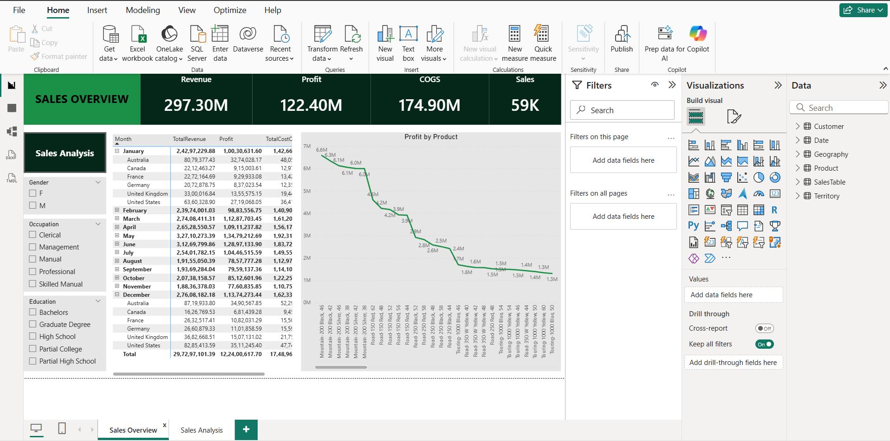
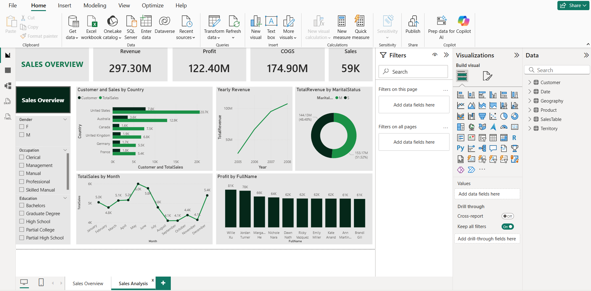

# Sales Performance & Business Intelligence Dashboard

An interactive sales analytics and business intelligence dashboard developed using **Microsoft Power BI**, focusing on revenue, profitability, product performance and customer insights.

## Project Overview

This project focuses on analyzing sales data to identify business trends, evaluate financial performance and generate meaningful insights through interactive Power BI dashboards.

## Tools & Technologies

- Microsoft Power BI
- Power Query
- DAX (Data Analysis Expressions)
- Excel
- Data Modelling
- Data Visualization

## Key Features

- **Sales Overview:** Track total revenue, profit, cost of goods sold (COGS) and sales.
- **Sales Analysis:** Analyze product profitability, customer distribution and country-wise sales performance.
- **Data Transformation:** Clean and transform raw datasets using Power Query.
- **DAX Calculations:** Create measures and KPIs for business performance analysis.
- **Interactive Reporting:** Use slicers, filters and visualizations to explore sales trends.

## Dashboard Preview

### 1. Sales Overview

### 2. Sales Analysis

## Key Insights

- Analyzed revenue and profit performance across different periods.
- Examined product-level profitability and sales distribution.
- Explored customer demographics and geographical sales patterns.
- Identified monthly and yearly sales trends to support business analysis.

## Project Files

| File | Description |
|---|---|
| `Sales Overview.pbix` | Complete Power BI dashboard |
| `Power-BI-Project-AdventureWorksxlsx.xlsx` | Source dataset |
| `Overview.png` | Sales Overview dashboard screenshot |
| `Analysis.png` | Sales Analysis dashboard screenshot |

## Learning Outcomes

- Hands-on experience with Power BI dashboard development.
- Practical application of Power Query for data cleaning and transformation.
- Understanding of data modelling and DAX calculations.
- Development of interactive business intelligence reports.
